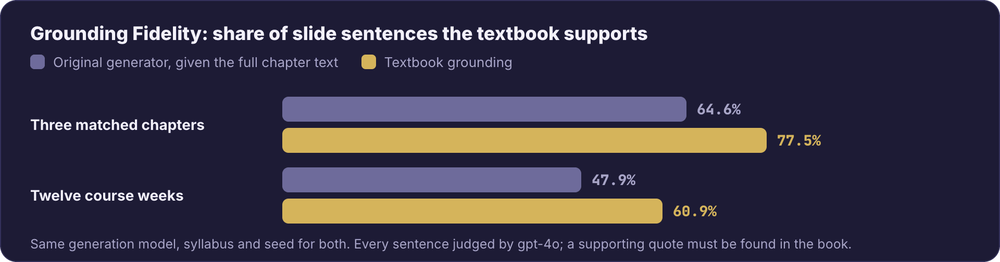

<div align="center">

# Instructional Agents: Reducing Teaching Faculty Workload through Multi-Agent Instructional Design

[](https://pypi.org/project/instructional-agents/)
[](https://www.python.org/downloads/)
[](https://fastapi.tiangolo.com/)
[](LICENSE)

<p align="center">
  <a href="https://darl-genai.github.io/instructional_agents_homepage/"></a>
  &nbsp;&nbsp;
  <a href="https://github.com/DaRL-GenAI/instructional_agents"></a>
</p>

[**Claude Code**](#use-via-claude-code) · [**Quick Start**](#-quick-start-docker---recommended) · [**Core Modules**](#-core-modules) · [**FAQ**](#-faq)

[🇨🇳 中文](README.zh.md) · [🇬🇧 English](README.md)


</div>

An AI-powered instructional design system based on the ADDIE model for automated course creation and evaluation.

```
@misc{yao2025instructionalagentsllmagents,
  title={Instructional Agents: Reducing Teaching Faculty Workload through Multi-Agent Instructional Design},
  author={Yao, Huaiyuan and Xu, Wanpeng and Turnau, Justin and Kellam, Nadia and Wei, Hua},
  year={2025},
  eprint={2508.19611},
  archivePrefix={arXiv},
  primaryClass={cs.AI},
  url={https://arxiv.org/abs/2508.19611},
}
```

The opt-in [textbook grounding](#textbook-grounding) feature is described in *Citations Are Not Enough: Grounding AI-Generated Instructional Materials in Real Sources* (AI-Native Academia Workshop at NeurIPS 2026).

---

### 📰 News

> **[2026.9.27]** The textbook grounding paper is accepted at the AI-Native Academia Workshop at NeurIPS 2026. See [Textbook Grounding](#textbook-grounding).
>
> **[2026.1.6]** Instructional Agents is accepted by EACL 2026 Main Conference!

### 📦 Releases

> **[2026.4.15]** Released [Claude Code Skills](https://github.com/DaRL-GenAI/instructional_agents-skills) - invoke the pipeline directly from Claude Code: `/plugin install DaRL-GenAI/instructional_agents-skills`
>
> **[2026.4.13]** Release [v1.1.0](https://github.com/DaRL-GenAI/instructional_agents/releases) - Added [LaTeX-to-PPTX conversion](#latex-to-pptx-conversion) with pptxgenjs, Slide Masters, react-icons, and shadow effects
>
> **[2026.3.26]** Published on [PyPI](https://pypi.org/project/instructional-agents/) - `pip install instructional-agents`

<details>
<summary>History releases</summary>

> **[2026.1.6]** [v1.0.0](https://github.com/DaRL-GenAI/instructional_agents/releases) - Initial release with core features - Thanks to all the contributors! ❤️
>
> **[2026.1.4]** [v0.1.0](https://github.com/DaRL-GenAI/instructional_agents/releases) - Docker deployment and web interface support

</details>

---

## ✨ Features

| Feature | Description |
|---------|-------------|
| 🤖 **Multi-Agent Collaboration** | Multiple specialized LLM agents working together based on ADDIE instructional design model |
| 📚 **Automated Course Generation** | Generate complete course materials including syllabus, slides, scripts, and assessments |
| 🎯 **Catalog Mode** | Use structured catalog files to guide course generation with student profiles and institutional requirements |
| 🤝 **Copilot Mode** | Interactive mode for providing feedback during generation at each ADDIE phase |
| 📊 **Real-time Progress** | Monitor generation progress with real-time logs, progress bars, and file updates |
| 🌐 **Web Interface** | User-friendly web interface for course generation, progress monitoring, and file management |
| 📁 **Multiple Usage Methods** | Support for web interface, command-line, and RESTful API |
| 📄 **LaTeX/PDF Output** | Generate professional LaTeX slides and compile to PDF format |
| 🎨 **PowerPoint (PPTX) Export** | Convert LaTeX Beamer slides to visually rich PPTX using pptxgenjs with icons, shadows, and Slide Masters |
| ✅ **Automatic Evaluation** | Built-in evaluation system for assessing generated course materials |
| 📖 **Textbook Grounding** | *(opt-in)* Write the course from a PDF or markdown textbook and check every slide sentence against it. Available on CLI, API, and Web UI. [More](#textbook-grounding) |

### 🎬 How It Works

<p align="center">
  
</p>

---

<a id="use-via-claude-code"></a>

## 🤖 Use via Claude Code

Invoke the full ADDIE pipeline and related tools directly from [Claude Code](https://claude.com/claude-code) — no Python boilerplate.

```bash
pip install instructional-agents
/plugin install DaRL-GenAI/instructional_agents-skills
```

Then ask Claude in natural language: *"Generate a course on Reinforcement Learning"*, *"Convert this Beamer .tex to an editable .pptx"*, *"Evaluate these slides as a Program Chair"*. See the [skills repo](https://github.com/DaRL-GenAI/instructional_agents-skills) for all available commands.

---

## 🚀 Quick Start (Docker - Recommended)

This guide will walk you through the complete workflow from setup to viewing results.

<details>
<summary><b>Step 1: Environment Setup</b></summary>

#### 1.1 Prerequisites

- **Docker** and **Docker Compose** installed
  - Check installation: `docker --version` and `docker-compose --version`
  - Install: [Docker Desktop](https://www.docker.com/products/docker-desktop)
- **OpenAI API Key**
  - Get one from: https://platform.openai.com/api-keys

#### 1.2 Configuration

```bash
# Clone the repository (if not already done)
git clone <repository-url>
cd instructional_agents

# Create environment variables file
cp .env.example .env

# Edit .env file and add your OPENAI_API_KEY
# OPENAI_API_KEY=your_api_key_here
# API_PORT=8000
```

> **Note**: You can also configure the API key directly in the web interface (see Step 2.2). If you skip setting it in `.env`, you'll need to enter it in the frontend.

#### 1.3 Start Docker Service

```bash
# Option 1: Use the start script (recommended)
./start.sh

# Option 2: Start manually
docker-compose up -d

# Verify service is running
curl http://localhost:8000/health
# Should return: {"status":"healthy","version":"1.0.0",...}
```

> **Tip**: If port 8000 is already in use, modify `API_PORT` in your `.env` file.

</details>

---

<details>
<summary><b>Step 2: Access Web Interface</b></summary>

#### 2.1 Open the Frontend

**Option A: Direct file access** (simplest)
```bash
# Open frontend/index.html directly in your browser
open frontend/index.html  # macOS
# or double-click frontend/index.html in your file manager
```

**Option B: Local server** (recommended for better CORS support)
```bash
# Using Python
cd frontend
python -m http.server 8080
# Then open http://localhost:8080/index.html in your browser
```

#### 2.2 Configure API Key

1. In the web interface, locate the **"API Configuration"** section at the top
2. Enter your OpenAI API Key in the input field
3. Click **"Save API Key"** to save it (stored locally in your browser)
4. The status indicator will show "✅ API Key Configured" when successful

> **Note**: Your API key is only stored in your browser's local storage and never sent to any server except OpenAI during course generation.

#### 2.3 Submit a Course Generation Task

1. **Fill in the course configuration form**:
   - **Course Name** (required): e.g., "Introduction to Machine Learning"
   - **Model Selection**: Choose from GPT-4o Mini (recommended), GPT-4o, or GPT-4 Turbo
   - **Experiment Name**: Leave as "default" or specify a custom name
   - **Copilot Mode**: Enable for interactive feedback during generation (optional)
   - **Catalog Mode**: 
     - Select "Not Use" for basic generation
     - Select "Upload Catalog File" to upload a custom catalog JSON
     - Select "Use Default Catalog" to use the default catalog
   - **Textbook grounding** *(optional)*: upload one or more PDF/markdown files via the picker labelled "Textbook grounding (optional)". Leave empty to skip.

2. **Click "Generate Course"** to start the task

3. To look at the Generation Procedure on the following, please go to Step 3 and 4:
   - Progress bar showing completion percentage
   - Current stage information
   - Real-time logs stream

</details>

---

<details>
<summary><b>Step 3: Monitor Progress and Logs</b></summary>

If you need to view logs outside the web interface:

```bash
# View container logs in real-time
docker-compose logs -f api

# View last 100 lines
docker-compose logs --tail=100 api

# View logs for a specific time range
docker-compose logs --since 30m api
```

</details>

---

<details>
<summary><b>Step 4: View Generated Results</b></summary>

#### 4.1 Via Web Interface (Recommended)

Once generation starts, the **"Generation Results"** section will appear showing:

1. **File Location**:
   - Displays the local path where files are saved
   - Example: `/Users/your_username/PycharmProjects/instructional_agents/exp/your_experiment_name/`
   - Quick actions:
     - **📋 Copy Path**: Copy the path to clipboard
     - **📂 Open Directory**: Open the directory in Finder/Explorer

2. **File List** (updates incrementally):
   - Files appear as they are generated (no need to wait for completion)
   - Each file shows:
     - File icon based on type (📝 .md, 📄 .tex, 📕 .pdf, 📋 .json)
     - File name and size
     - **🆕 New** badge for newly generated files
     - **📥 Download** button for immediate download

3. **File Organization**:
   - Files are grouped by directory
   - Foundation files (syllabus, goals, etc.) in the root
   - Chapter materials in `chapter_1/`, `chapter_2/`, etc.

#### 4.2 Via File System

Generated files are saved in the `exp/` directory in your project folder:

```bash
# List all experiments
ls exp/

# View a specific experiment's structure
ls -R exp/your_experiment_name/

# Open in Finder (macOS)
open exp/your_experiment_name/

# Open in Explorer (Windows)
explorer exp\\your_experiment_name\\

# View course syllabus
cat exp/your_experiment_name/result_syllabus_design.md

# View generated slides PDF
open exp/your_experiment_name/chapter_1/slides.pdf
```

**File Structure**:
```
exp/{experiment_name}/
├── result_instructional_goals.md          # Learning objectives
├── result_resource_assessment.md          # Resource assessment
├── result_target_audience.md              # Target audience analysis
├── result_syllabus_design.md              # Course syllabus (⭐ important)
├── result_assessment_planning.md          # Assessment planning
├── result_final_exam_project.md           # Final project design
├── result_presentation_design.md          # Seventh foundation: course-wide presentation design
├── processed_chapters.json                # Chapter metadata
├── course_slide_style.json                # Validated course-wide frontend style
├── course_slide_style_source.md           # Exact selected style source snapshot
├── statistics_slide_style.json            # Style deliberation timing/tokens
├── statistics.json                        # Generation statistics
│
├── chapter_1/                             # Chapter 1 materials
│   ├── slides.tex                         # LaTeX source
│   ├── slides.pdf                         # Compiled PDF slides (⭐ ready to use)
│   ├── html/                              # Portable offline HTML bundle
│   │   ├── slides.html                    # Offline interactive HTML slides
│   │   └── assets/                        # Offline MathJax and selected fonts
│   ├── slides-html.pdf                    # PDF exported from the HTML deck
│   ├── slides-html.pptx                   # Static image-based HTML export
│   ├── frontend-slides-manifest.json      # Hashes, counts, warnings, artifacts
│   ├── slides.pptx                        # PowerPoint slides (⭐ editable)
│   ├── script.md                          # Presentation script
│   ├── assessment.md                      # Assessment materials
│   └── statistics_slides_chapter_1.json   # Chapter statistics
│
├── chapter_2/                             # Chapter 2 materials
│   └── ...
└── ...
```

> **Tip**: Files are generated incrementally. You can download or view them as soon as they appear, without waiting for the entire generation to complete.

Each generated `script.md` is validated one-to-one against the rendered HTML
slides. Press `N` in `html/slides.html` to toggle the offline presenter-notes
panel; the panel is excluded from static PDF and PPTX exports.

For detailed file descriptions, see [Generated Files Guide](docs/FILES_GENERATED.md).

</details>

---

<details>
<summary><b>Step 5: Next Steps</b></summary>

See [Documentation](#-documentation) section below for detailed guides and references.

</details>

---

## 📦 Install via PyPI

```bash
pip install instructional-agents
```

After installation, you can run the CLI directly:

```bash
# Set your OpenAI API key
export OPENAI_API_KEY=your_api_key_here

# Generate a course
instructional-agents "Introduction to Machine Learning"
```

---

## 🔧 Local Development Setup

For developers who want to run the system locally from source:

### 1. Prerequisites

- Python 3.11+
- pip
- LaTeX (for PDF generation)
  - macOS: `brew install --cask mactex`
  - Ubuntu: `sudo apt-get install texlive-full`
  - Windows: Install [MiKTeX](https://miktex.org/)
- Node.js 18+ (for PPTX generation)
  - macOS: `brew install node`
  - Ubuntu: `sudo apt-get install nodejs npm`
  - Windows: Install from [nodejs.org](https://nodejs.org/)

### 2. Install Dependencies

```bash
# Vanilla install — minimal footprint, supports the standard
# course-writing pipeline (no textbook grounding).
pip install -e .

# Light install + textbook grounding (`--use-textbook PATH`).
# Adds pymupdf, pymupdf4llm, markdown-it-py, rank-bm25, fastembed (ONNX-based
# bi-encoder and cross-encoder via onnxruntime; no torch dep).
# ~100 MB total on top of the base install.
pip install -e ".[grounding]"

# All-in-one (also installs the optional chromadb extras and any
# grounding deps): keeps the prior `requirements.txt`-based workflow
# working unchanged.
pip install -r requirements.txt

# Node.js dependencies (for PPTX generation)
npm install -g pptxgenjs

# Optional: install react-icons for slide icons (recommended)
npm install -g react-icons react react-dom sharp
```

> **Note**: `pptxgenjs` is required for LaTeX-to-PPTX conversion. The `react-icons` + `sharp` packages are optional but recommended — they add topic-specific icons to each slide (e.g., 🤖 for agent topics, 🧠 for AI topics). Without them, slides will use simple geometric shapes instead.

### 3. Configuration

**Option A: Using config.json**
```json
{
  "OPENAI_API_KEY": "your_openai_api_key_here"
}
```

**Option B: Using environment variable**
```bash
export OPENAI_API_KEY=your_api_key_here
```

### 4. Start API Server

```bash
# Start the API server
python api_server.py

# Or use uvicorn directly with auto-reload
uvicorn api_server:app --host 0.0.0.0 --port 8000 --reload
```

The API will be available at `http://localhost:8000`
- API Documentation: http://localhost:8000/docs
- Health Check: http://localhost:8000/health

---

## 🚀 Usage Methods

### Method 1: Web Interface (Recommended)

The easiest way to use the system. See Step 2 above for detailed instructions.

**Features**:
- 📝 Visual course configuration form
- 📊 Real-time progress monitoring
- 📁 Result file browsing and download
- 📤 Catalog file upload and management
- 🔄 Real-time log streaming

### Method 2: Command Line

**Entry Point**: `run.py` – Main workflow entry point

```bash
# Simple course generation
python run.py "Introduction to Machine Learning"

# With specific model
python run.py "Data Structures" --model gpt-4o-mini

# With experiment name
python run.py "Web Development" --exp web_dev_v1

# Interactive copilot mode
python run.py "Database Systems" --copilot

# Use catalog mode
python run.py "Software Engineering" --catalog

# Use specific catalog file
python run.py "AI Fundamentals" --catalog ai_catalog

# Combine catalog and copilot
python run.py "Educational Psychology" --copilot --catalog edu_psy

# Ground the course in a textbook (PDF/markdown file or directory)
python run.py "Data Mining" --catalog default_catalog \
    --use-textbook path/to/textbook.pdf

# Enable images with no numeric per-chapter cap
python run.py "Systems Thinking" --image-generation on --image-count on

# Opt in to Carbon-rendered code images
python run.py "Programming Languages" --code-images on
```

**Minimal Working Example** (generates a small 3-week course in ~5 min):
```bash
python run.py "Intro to Python" --catalog mwe_catalog --exp mwe_test --seed 42
```

**Command Line Arguments**:
```bash
python run.py <course_name> [OPTIONS]

Required:
  course_name              Name of the course to design

Options:
  --copilot                Enable interactive copilot mode
  --catalog [name]         Use structured data from catalog/ directory
                           (optional: specify catalog name without '.json')
  --model MODEL            OpenAI model to use (default: gpt-4o-mini)
  --exp EXP_NAME           Experiment name for saving output (default: exp1)
  --seed SEED              Random seed for reproducibility
  --temperature TEMP       Sampling temperature for LLM
  --use-textbook PATH      Ground course generation in a textbook (PDF or
                           markdown file, or a directory of either). When
                           omitted, generation runs identically to a vanilla
                           run — no grounding is applied.
  --only-chapters N[,N]    Generate only these 1-based chapters (e.g. "2,5");
                           every other chapter is skipped. Pair with --resume
                           to redo one chapter after feedback.
  --no-strict-verification Grounded runs only: judge claims against the
                           writer's excerpts (capped, cheaper) instead of the
                           complete bound source with second-chance passes.
  --verifier-model MODEL   Grounded runs only: model for the content-fidelity
                           verifier (default: the verifier's own default).
  --image-generation {on,off,replace}
                           Enable, disable, or replace generated slide images
  --image-count {on,off}   Turn AI-selected image counts on or off; when on,
                           the count is always automatic
  --code-images {on,off}   Use Carbon code images or styled HTML code blocks
  --optimize STORAGE_ID    Optimize mode: provide storage_id of uploaded PDFs
  --requirements TEXT      User requirements for optimization (with --optimize)
  --chapter NAME           Specific chapter to optimize (with --optimize)
```

Dynamic slide images are off by default. When enabled, the presentation-design
deliberation may still veto imagery. Use `--image-count on` to remove the fixed
numeric budget and always let the placement AI choose the count. Use
`--image-count off` to restore the experiment's stored fixed cap (3 by default).
Omitting the flag preserves the current experiment setting. The placement AI
may choose zero, five, six, or any other number up to the chapter's eligible
slides while automatic counting is on.
Generated images appear only in the HTML, HTML-derived PDF, and HTML-derived
PPTX; the Beamer source and PDF are unchanged. See
[`docs/BETTER_SLIDES_GENERATION.md`](docs/BETTER_SLIDES_GENERATION.md)
for cache and replacement behavior.

Carbon code images are also off by default. `--code-images on` persists the
choice in `course_code_images.json` and applies it to every chapter. The first
enabled chapter that actually contains a `lstlisting` or `verbatim` block uses
an existing `carbon-now` executable or runs
`npm install --global carbon-now-cli@2.1.0`. This is an explicit global npm
installation; Node.js and npm must already be installed and are never installed
automatically. Missing prerequisites, installation failures, network failures,
timeouts, or invalid Carbon output produce warnings and retain the styled
editable `<pre>` block. Successful PNGs are cached by content, language, theme,
pipeline, and Carbon version, then embedded directly in the self-contained
HTML. They therefore appear in the HTML-derived PDF and PPTX, while
`slides.tex` and the Beamer PDF remain unchanged. Use `--code-images off` to
persistently return the course to `<pre>` rendering.

### Method 3: Direct API Calls

**API Server**: `api_server.py` – RESTful API service

```bash
# Start API server first (if not using Docker)
python api_server.py

# Generate a course
curl -X POST http://localhost:8000/api/course/generate \
  -H "Content-Type: application/json" \
  -H "X-OpenAI-API-Key: your_api_key_here" \
  -d '{
    "course_name": "Introduction to Machine Learning",
    "model_name": "gpt-4o-mini",
    "exp_name": "ml_intro_v1"
  }'

# Check task status
curl http://localhost:8000/api/course/status/{task_id}

# Get result files
curl http://localhost:8000/api/course/results/{task_id}/files

# Download a file
curl http://localhost:8000/api/course/results/{task_id}/download/chapter_1/slides.pdf \
  --output slides.pdf

# Textbook grounding (optional) — upload a textbook, then pass its
# returned `path` as `textbook_path` in /api/course/generate above
curl -X POST http://localhost:8000/api/textbooks/upload \
  -F "files=@chapter_1.pdf" -F "files=@chapter_2.pdf"
curl http://localhost:8000/api/textbooks/list
```

For complete API documentation, see [API Documentation](docs/API_DOCUMENTATION.md).

---

## 🔧 Core Modules

| Module | Description | Usage |
|--------|-------------|-------|
| **Course Generation** | Generate complete course materials based on ADDIE model | Web interface, CLI (`run.py`), or RESTful API |
| **Catalog Mode** | Use structured catalog files for guided generation | `--catalog` flag or upload in web interface |
| **Copilot Mode** | Interactive feedback during generation | `--copilot` flag in CLI or enable in web interface |
| **Textbook Grounding** | Write the course from a PDF or markdown textbook and check every slide sentence against it | `--use-textbook PATH` flag in CLI, `textbook_path` in API, file picker in web interface |
| **Evaluation** | Automatic assessment of generated materials, with an optional Grounding Fidelity % | `python evaluate.py --exp <exp_name> [--rigorous]` |
| **Web Interface** | Visual interface for course generation | Open `frontend/index.html` in browser |
| **API Server** | RESTful API for programmatic access | `python api_server.py` or Docker |

---

## 📚 Advanced Usage

### Catalog Mode

Catalog files provide structured input data to guide the course generation process. They include:
- Student profiles and backgrounds
- Instructor preferences and teaching style
- Optional presentation style preferences, including visual direction, colors,
  typography, layout density, accessibility needs, and styles to avoid
- Course structure requirements
- Assessment design preferences
- Teaching constraints
- Institutional requirements

**Using Catalogs**:
```bash
# Use default catalog
python run.py "Software Engineering" --catalog

# Use a specific catalog file (without .json extension)
python run.py "AI Fundamentals" --catalog ai_catalog
# System looks for: catalog/ai_catalog.json

# Upload catalog via web interface
# In the web interface, select "上传 Catalog 文件" and upload your JSON file
```

See [API Documentation](docs/API_DOCUMENTATION.md#catalog-format) for catalog format details.

`presentation_style_preferences` is advisory. The presentation-design agents
consider every non-empty preference when comparing packaged styles, while
accessibility, readability, course suitability, and rendering feasibility take
priority when a preference conflicts with the available designs. The selected
style remains frozen on resume; use a new experiment or
`--reselect-presentation-design` with `run.py` to apply changed
preferences.

### Copilot Mode

Interactive mode that prompts for feedback after each phase of the ADDIE workflow:
- **Analysis** phase: Review and provide feedback on learning goals, resource assessment, target audience
- **Design** phase: Review and refine syllabus design, assessment planning, final project
- **Development** phase: Review and adjust chapter materials as they're generated

```bash
python run.py "Advanced Algorithms" --copilot --exp algo_course_v2
```

### Textbook Grounding

Write the course from an assigned textbook and check every slide sentence against it. It is opt-in: without `--use-textbook`, nothing changes.

<p align="center">
  
</p>

**Why.** A model given the whole chapter in its prompt still writes much that the book does not say. Grounding chooses which passages each slide may use, then measures how much of the deck the book supports.

<p align="center">
  
</p>

**Usage.** Pass a PDF, a markdown file, or a directory of either:

```bash
python run.py "Data Mining" --catalog default_catalog --exp dm_grounded \
    --use-textbook path/to/textbook.pdf
```

Each chapter folder gets a `content_verification.json` that marks every slide sentence as supported, with its quote from the book, or flagged, with the reason. `--only-chapters N[,N]` regenerates chosen chapters, `--verifier-model MODEL` picks the judge, and `--no-strict-verification` runs a cheaper check against the writer's excerpts. The parsed book is cached after the first run.

**Results** (from the paper). Grounding Fidelity is the share of slide sentences the textbook supports.

<p align="center">
  
</p>

<details>
<summary>What each part adds, week-by-week results, and how it works under the hood</summary>

<p align="center">
  
</p>

<p align="center">
  
</p>

- **Parse.** `pymupdf4llm` turns the textbook into chapters, sections and paragraphs. Images of equations become LaTeX through a small vision-model pass, cached per book.
- **Index.** Paragraphs become ~512-token chunks, searched by BM25 and by dense embeddings (`text-embedding-3-large`), fused by reciprocal rank fusion.
- **Bind.** Each week's topic is split into subtopics and expanded into search queries. Section rankings are fused across the queries, and a book-relative gate picks the week's sections. A weak match still binds its best sections, with the low confidence recorded.
- **Write.** Each slide's prompt carries its retrieved passages and grounding rules: teach in your own words, keep worked examples and notation, add nothing the passages do not support. Deterministic passes place figures and captions and clean up the LaTeX.
- **Check.** The deck is split into sentences, leaving out titles and headings. Each sentence is judged against the full text of the week's sections, and a "supported" verdict counts only if its quote is found word for word. Loosely quoted passes and first-time flags get one more focused check. The check never edits the deck.

</details>

The code as evaluated in the paper is tagged [`paper-neurips2026-evaluated`](https://github.com/shrey-Bish/instructional_agents/tree/paper-neurips2026-evaluated).

### Automatic Evaluation

**Entry Point**: `evaluate.py` – Automatic assessment and scoring

```bash
# Rubric scoring + Program-Chair / Test-Student validation
python evaluate.py --exp web_dev_v1

# Measurement-grade scoring + a binary Grounding Fidelity % on grounded runs
python evaluate.py --exp dm_grounded --rigorous
```

Evaluation results are saved in the `eval/{experiment_name}/` directory. The default run is a 1–5 multi-agent rubric. `--rigorous` adds deterministic scoring (fixed seed, median-of-3), a `core_quality` headline (excluding metrics a slide deck structurally can't satisfy), and, on grounded runs, a **Grounding Fidelity %** summed from the per-chapter fidelity reports.

### LaTeX-to-PPTX Conversion

Convert generated LaTeX Beamer slides to editable PowerPoint presentations with professional design:

```bash
# Convert a single chapter
python -c "
from src.latex_to_pptx import LaTeXToPPTXConverter
converter = LaTeXToPPTXConverter()
converter.convert('exp/my_course/chapter_1/slides.tex', 'exp/my_course/chapter_1/slides.pptx')
"

# Convert all chapters in a course
python -c "
from src.latex_to_pptx import LaTeXToPPTXConverter
converter = LaTeXToPPTXConverter()
converter.convert_directory('exp/my_course/')
"
```

**PPTX Design Features:**
- 🎨 **Midnight Executive palette** — navy/ice-blue/orange color scheme with Georgia/Calibri fonts
- 📐 **Slide Masters** — consistent layouts via `CONTENT_MASTER`, `CONTENT_CODE`, and `DARK_MASTER`
- 🌓 **Dark/light sandwich** — dark slides for title/conclusion, light for content
- 🔤 **Smart icons** — topic-aware icons from react-icons (robot, brain, code, etc.) in colored circles
- 🎭 **Varied layouts** — auto-detected: single-text, list-only, blocks, code, columns, mixed
- 💫 **Visual polish** — shadows on blocks/code, sidebar accent motif, decorative circles
- 📏 **Typography** — 36pt+ titles, 14-16pt body, auto-scaling for long titles

**Architecture**: `LaTeX .tex → [Python LaTeXParser] → JSON → [Node.js pptxgenjs] → .pptx`

### Background Execution with Logging

For long-running tasks, run in the background:

```bash
# Run in background with log file
nohup python run.py "Advanced Machine Learning" --exp ml_advanced > logs/ml_course.log 2>&1 &

# Monitor progress
tail -f logs/ml_course.log

# Check process status
ps aux | grep "python run.py"
```

---

## 📚 Example Workflows

### Complete Course Design

```bash
# Step 1: Generate course using catalog
python run.py "Python Fundamentals" \
  --catalog python_catalog \
  --model gpt-4o \
  --exp py_course_v1

# Step 2: Evaluate results
python evaluate.py --exp py_course_v1

# Step 3: Review generated materials
open exp/py_course_v1/result_syllabus_design.md
open exp/py_course_v1/chapter_1/slides.pdf
```

### Interactive Development (Copilot)

```bash
python run.py "Advanced Algorithms" --copilot --exp algo_course_v2

# You'll be prompted for feedback after each phase:
# - Analysis → feedback on goals, resources, audience
# - Design → feedback on syllabus, assessments
# - Development → feedback on chapter materials
```

### Textbook-Grounded Course

```bash
# Step 1: Generate course grounded in a textbook
python run.py "Data Mining" --catalog default_catalog --exp dm_grounded \
  --use-textbook path/to/textbook.pdf

# Step 2: Evaluate with the Grounding Fidelity % (rigorous mode)
python evaluate.py --exp dm_grounded --rigorous

# Step 3: Review per-chapter content-fidelity logs (claims supported vs. unsupported)
open exp/dm_grounded/chapter_1/content_verification.json
```

---

## 📖 Documentation

| [API Documentation](docs/API_DOCUMENTATION.md) | [Docker Deployment](docs/README_DOCKER.md) | [Generated Files Guide](docs/FILES_GENERATED.md) |
|------------------------------------------------|---------------------------------------------|---------------------------------------------------|
| Complete API reference and endpoints           | Docker setup and deployment guide           | Detailed description of generated files          |

| [Workflow Documentation](docs/WORKFLOW_DOCUMENTATION.md) | [Development Guide](docs/README.md) | |
|----------------------------------------------------------|--------------------------------------|--|
| System workflow and agent collaboration details          | Development and debugging documentation | |

---

## ❓ FAQ

<details>
<summary><b>How to configure API key?</b></summary>

**Checklist**
- Get OpenAI API key from https://platform.openai.com/api-keys
- Configure in `.env` file or web interface

**Solutions**
- **Option 1**: Set in `.env` file: `OPENAI_API_KEY=your_key_here`
- **Option 2**: Configure in web interface (stored in browser local storage only)

</details>

<details>
<summary><b>Port 8000 already in use?</b></summary>

**Problem**

Starting the service shows "port already in use" error.

**Solution**

```bash
# macOS/Linux: Find and kill the process
lsof -i :8000
kill -9 <PID>

# Or change port in .env file
API_PORT=8001
```

</details>

<details>
<summary><b>How to use catalog files?</b></summary>

**Checklist**
- Catalog files should be in JSON format
- Place catalog files in `catalog/` directory

**Solutions**
- **Default catalog**: Use `--catalog` without value to use `catalog/default_catalog.json`
- **Custom catalog**: Use `--catalog my_catalog` to use `catalog/my_catalog.json`
- **Web interface**: Upload catalog file directly in the web interface

</details>

<details>
<summary><b>Where are generated files saved?</b></summary>

**Answer**

Generated files are saved in `exp/{experiment_name}/` directory:
- Foundation files (syllabus, goals, etc.) in the root
- Chapter materials in `chapter_1/`, `chapter_2/`, etc.
- Files are generated incrementally and can be downloaded as soon as they appear

</details>

<details>
<summary><b>Web interface cannot connect to backend?</b></summary>

**Checklist**
- Confirm backend is running (visit http://localhost:8000/docs or http://localhost:8000/health)
- Check browser console for error messages
- Verify API address configuration

**Solution**

- **Docker**: Ensure Docker container is running: `docker-compose ps`
- **Local**: Ensure API server is running: `python api_server.py`
- Check that the port matches (default: 8000)

</details>

<details>
<summary><b>What models are supported?</b></summary>

**Answer**

Currently supports OpenAI models:
- GPT-4o Mini (recommended, cost-effective)
- GPT-4o
- GPT-4 Turbo

Configure via model selection in web interface or `--model` flag in CLI.

</details>

---

## 📜 License

Instructional Agents is released under the [MIT License](LICENSE).

### Third-party attribution

The HTML slide style-selection assets in [`assets/slide_gen/skill`](assets/slide_gen/skill)
are adapted from [Frontend Slides](https://github.com/zarazhangrui/frontend-slides)
by Zara Zhang. Frontend Slides is used under the MIT License; its original
copyright notice and license terms are preserved in
[`assets/slide_gen/skill/LICENSE`](assets/slide_gen/skill/LICENSE).
